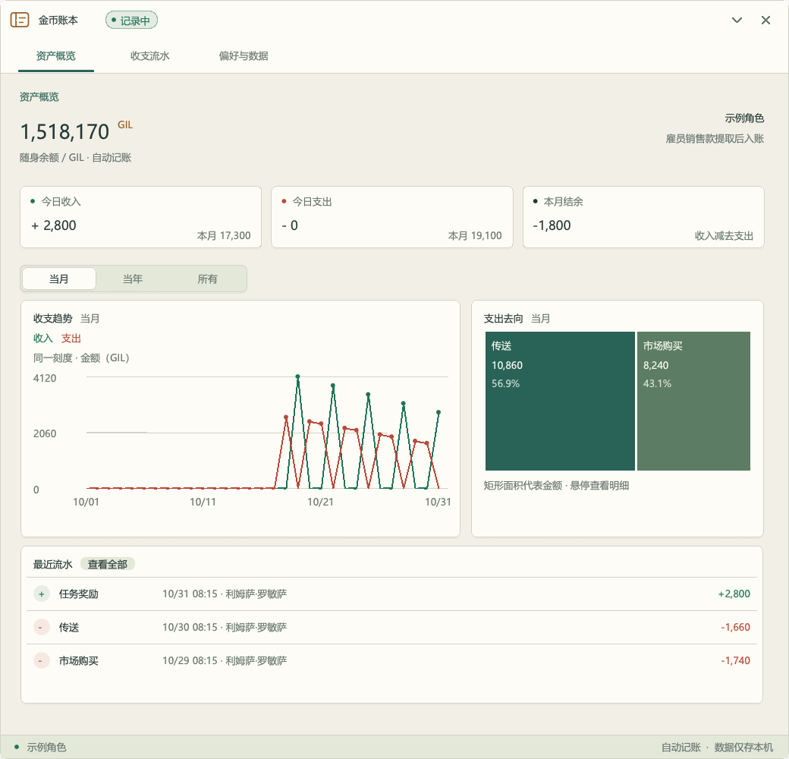
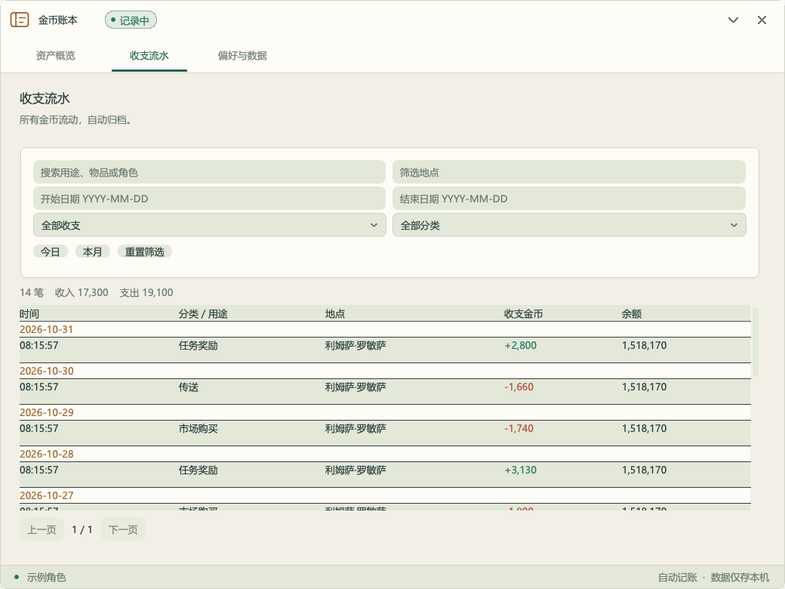
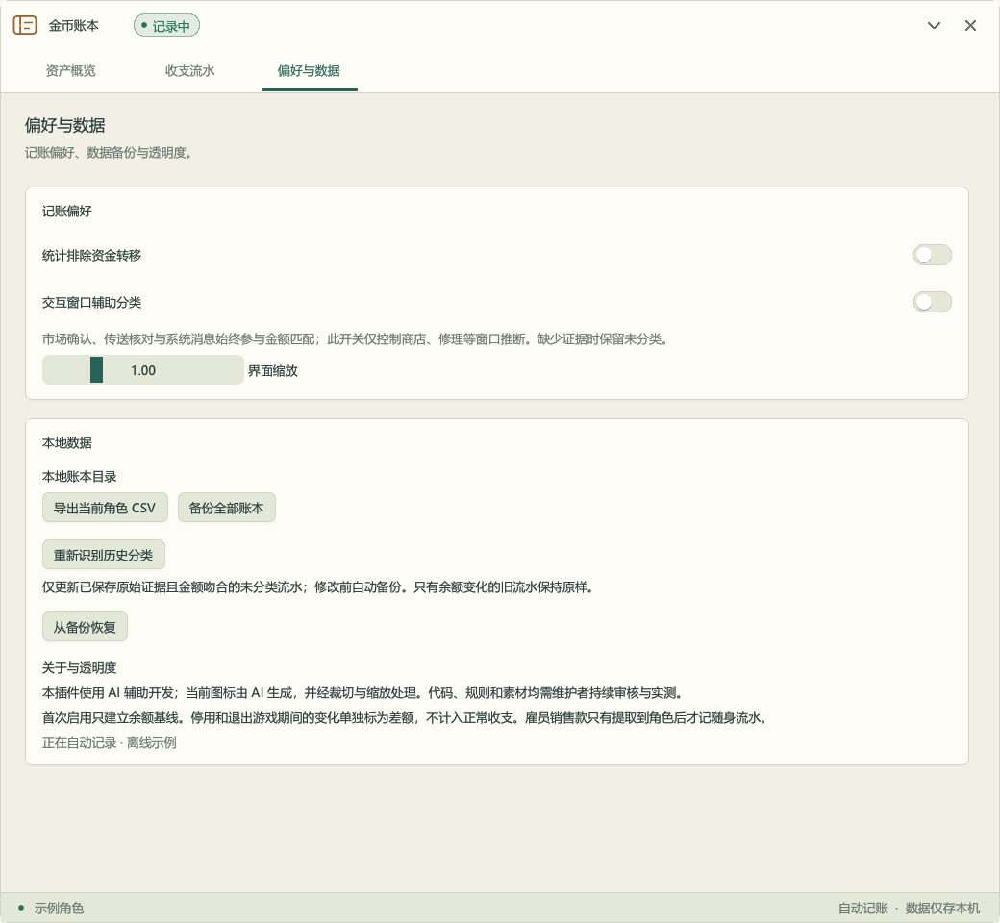

# 金币账本 · JiZhang

基于 Dalamud 的 FF14 自动金币账本。无需手动记账，自动记录当前角色的金币收入与支出，查看每笔交易的时间、地点、用途及余额变化。

## 功能

- **收支概览**：当前余额、今日与本月收支、净变化；支持当月、当年和全部历史。
- **图表分析**：收支趋势折线图、支出去向矩形树图，悬停查看金额与占比。
- **流水查询**：按时间、收入／支出、分类、地点和关键词筛选，查看交易详情。
- **自动分类**：结合实际扣款、系统奖励提示及市场确认识别用途，无法确认时保留未分类。
- **历史分类更新**：用已保存的原始证据重新识别未分类记录，修改前自动备份。
- **独立账本**：按角色保存，本地 SQLite 持久化，支持 CSV 导出、备份与恢复。
- **便捷操作**：`/jizhang` 打开窗口，支持界面缩放、窗口折叠和排除资金转移统计。

仅记录随身金币；雇员销售款在提取到角色钱包后入账，避免重复统计。不记录其他货币和纯物品变化。

## 界面预览

以下为当前插件原生 ImGui 界面的离线截图，使用示例数据。

### 收支概览



### 流水查询



### 偏好与数据



## 安装与使用

当前为 **0.1.1 开发预览**，正式订阅尚未开放。可从 [GitHub Actions](https://github.com/wynnforthework/FFXIV-JiZhang/actions) 下载 `JiZhang-development` 构建，或按 [本地开发说明](docs/DEVELOPMENT.md) 构建并加载开发插件。

加载后输入 `/jizhang`。首次启用只建立余额基线，后续实际金币变化会自动记录；停用或离线期间的余额差额单独保存，不计入正常收支。

正式发布后的订阅地址：

```text
https://raw.githubusercontent.com/wynnforthework/FFXIV-JiZhang/main/repo.json
```

## 旧流水能更新分类吗？

在 **偏好与数据 → 本地数据 → 重新识别历史分类** 中操作。只处理当前角色的未分类流水，并核对已保存系统消息中的金额。成功修改前会自动备份，不改变交易金额、时间、地点和余额。

旧版未分类记录通常只保存了余额变化，没有原始消息或传送请求。缺少这些证据时无法可靠还原用途，会保留未分类；更新规则不会把历史数据按金额或地点猜测分类。

## 数据与恢复

数据只保存在本机，实际目录显示于设置页。恢复会替换全部角色账本，原数据会自动保存为 `before-restore-*.sqlite`。详见 [分类规则与修正](docs/CLASSIFICATION_FIXES.md) 和 [游戏内验收清单](docs/ACCEPTANCE.md)。

## AI 使用披露

本插件的大部分代码及开发文档由 AI 根据维护者需求生成，图标为维护者提供的 AI 生成图片。详细参与情况和审查状态见 [AI 使用说明](docs/AI_USAGE.md)。

MIT License · [GitHub](https://github.com/wynnforthework/FFXIV-JiZhang)
